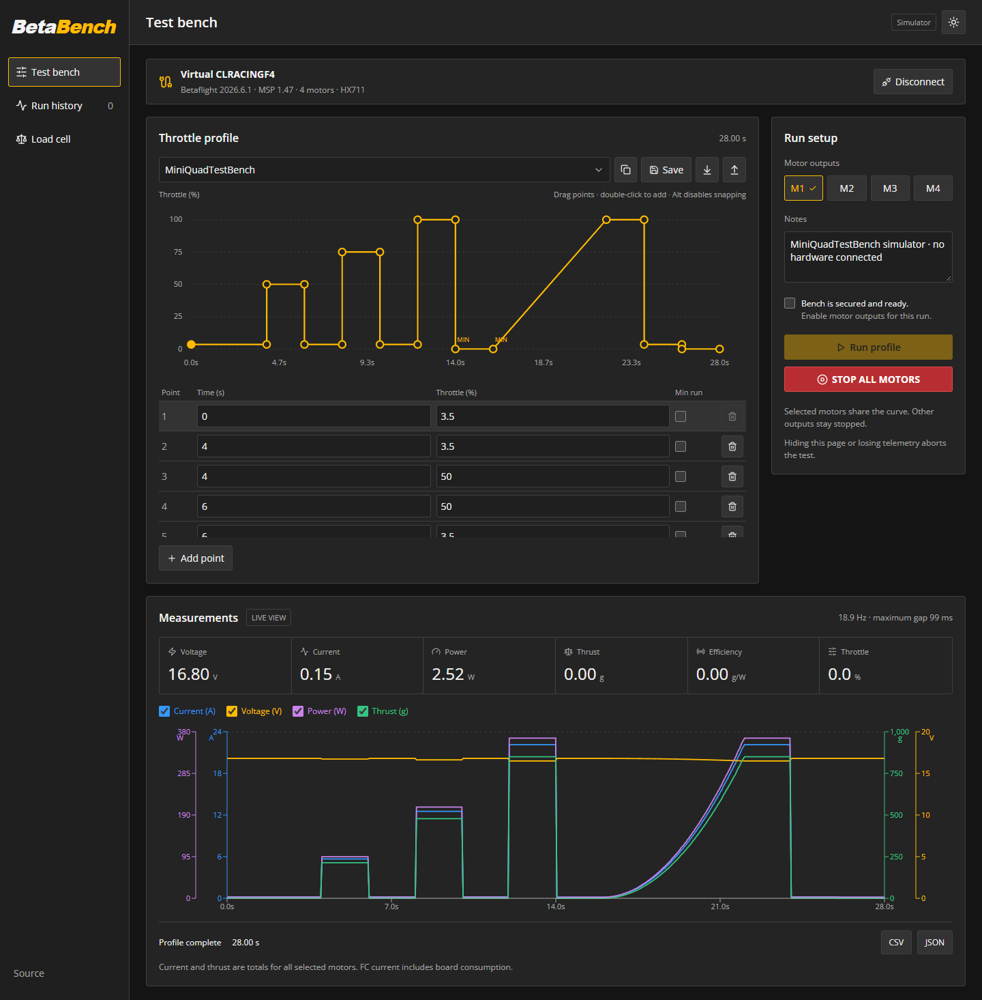
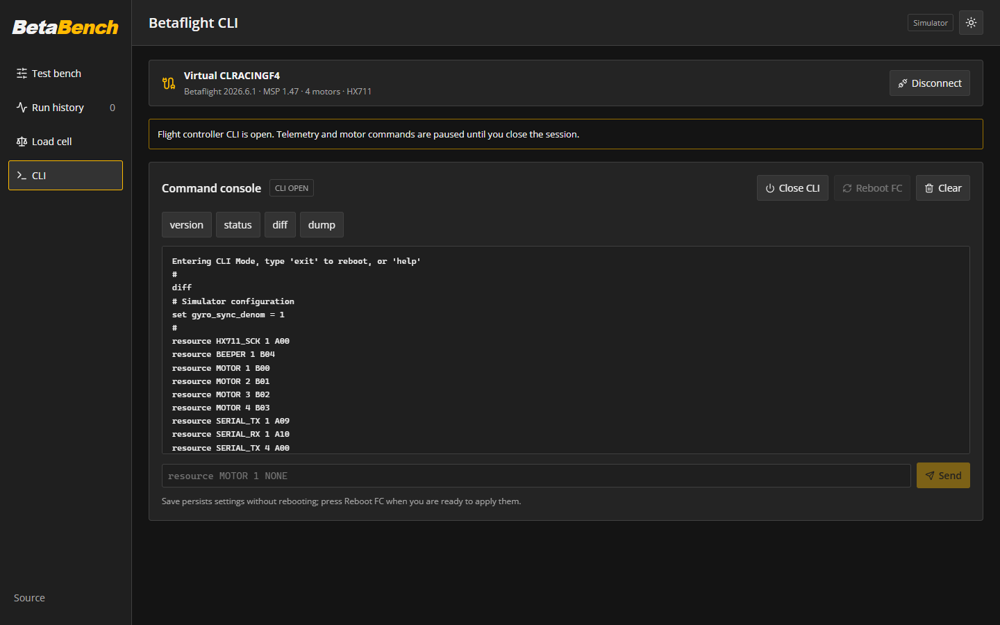
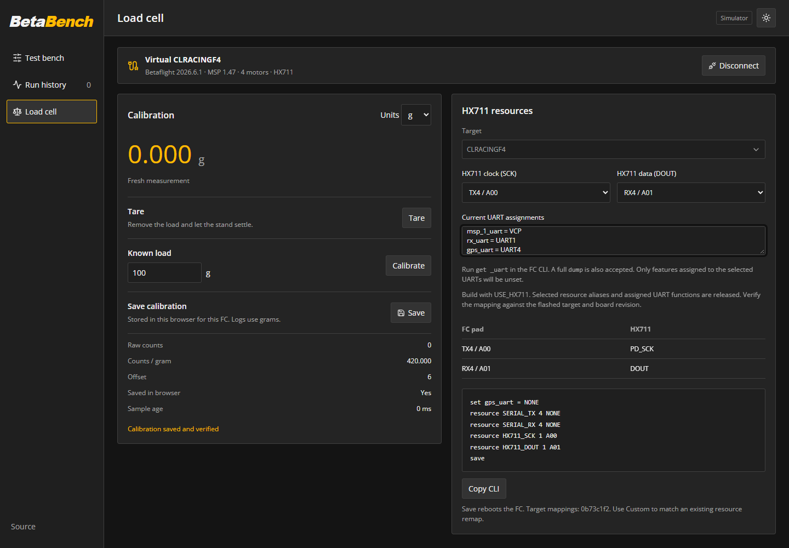

<picture>
  <source media="(prefers-color-scheme: dark)" srcset="public/brand/betabench-wordmark.svg">
  
</picture>

A browser-based motor and ESC test bench using a Betaflight flight controller.

**[Open Betabench](https://fractalengineer.github.io/Betabench/)** · [Implementation checklist](PLAN.md) · [Firmware and wiring](firmware/README.md) · [Firmware pull request #15868](https://github.com/betaflight/betaflight/pull/15868) · [MSP extension](firmware/PROTOCOL.md)



_MiniQuadTestBench simulator run; no hardware connected._

## Use

Open the app in desktop Chrome or Edge. Select **Try simulator** to explore without hardware, or **Connect FC** to choose the USB serial port. Close Betaflight Configurator first so the port is available.

Choose MiniQuadTestBench or the 0→100→0 sweep from the profile dropdown. Rename it in that same field, edit the timeline or point table, and select motor outputs. Save a copy to retain custom profiles. Secure the stand, enable the outputs for this run, and press **Run profile**. A three-second countdown precedes playback. Stop is always available while connected.

The measurements graph plots live telemetry as soon as a device is connected. Starting a run clears it and plots the recorded sequence; when the run ends the trace holds until you press **Run** on the graph. **Stop** freezes the trace without touching the motors, like an oscilloscope. **Manual motor test** drives each motor with its own slider while outputs are enabled; a slider holds its value until you change it or press **STOP ALL MOTORS**.

**CLI** opens a real Betaflight CLI session over the same USB connection, the way Configurator's CLI tab does, so you can read `diff`/`dump`, change settings, and save without leaving the browser. The FC pauses telemetry and motor control while the session is open, and arming stays disabled until it reboots.



_Simulator CLI session listing the FC resource map; no hardware connected._

The app requires Betaflight MSP API 1.42+ and conventional DShot150/300/600. Reversible/3D and inverted motor outputs are rejected. It reads the configured FC voltage/current sources; accurate electrical measurements require the FC sensors to be connected and calibrated. Shared current and thrust represent the selected motors together, including board consumption. Optional RPM and ESC temperature depend on configured telemetry support.

**Betaflight retains its last motor-test throttle after a browser crash or lost USB connection.** Keep a physical power cutoff available. Browser scheduling targets 50 Hz and is not a real-time control guarantee; measured rate and maximum telemetry gap appear in the UI. Hidden pages, command delays, stale telemetry, serial failures, and storage failures abort a run. Reconnection never resumes it.

## Profiles and results

- Drag individual points in time and throttle or edit them numerically. Nearby horizontal/vertical alignments snap into place; hold Alt to bypass snapping. Double-click to add points. Holds, linear ramps, explicit Stop, and minimum running throttle are distinct. A normal 0% endpoint means stopped; **MIN RUN** changes zero to DShot's minimum running command.
- MiniQuadTestBench is a normalized 28-second sequence; the triangular sweep defaults to six seconds each way.
- Profiles and runs are saved in IndexedDB in this browser and origin. Clearing browser/site data removes them. Browser history is not a backup: export runs you want to keep.
- CSV contains timestamped measurements with units, requested throttle/outputs, transmitted outputs, available FC output readback, and optional load-cell/RPM data. JSON contains the complete run and its profile, equipment notes, firmware identity, and calibration snapshot. JSON runs and profiles can be imported.
- Throttle, voltage, current, power, thrust and efficiency curves can be displayed together in distinct colors. History supports run overlays. Load-cell units can be g, kg, N or lbf; exported measurements remain in grams. Missing measurements stay empty; thrust efficiency is calculated only with valid thrust and power. Simulated runs are explicitly marked.

## Load cell



_Simulator load-cell setup with a manually selected target; no hardware connected._

Build the optional firmware with `USE_HX711`, connect an HX711 to free GPIO resources, then use **Load cell** to tare the empty stand, enter a known mass in grams, calibrate, and save in this browser for this FC UID. Capture needs stopped motors and stable samples. GPIO assignments alone are stored on the FC. Calibration and logs can be exported with run JSON.

Press **Detect** to read the FC's current assignments, including any HX711 pins it already has, then reuse or change them. Otherwise search for and explicitly select a target and choose repurposed pads; no target is preselected. The helper uses the selected target configuration to release every mapped resource on the two GPIOs, then assigns HX711 clock/data and saves. Motor, servo, LED, beeper, PINIO, ADC and bus resources are supported; **Custom GPIO…** accepts a GPIO directly. No port-assignment paste is required and no serial/protocol settings are changed. Custom supports resource dumps from remapped FCs. CLRACINGF4 can use TX4/PA0 for clock and RX4/PA1 for data, with USB for MSP. Copy the commands into Configurator, or press **Write to FC** to run them in a CLI session and save; reboot before the new pins are used. Pins are assigned through normal Betaflight CLI resources without changing the board target. See the [firmware guide](firmware/README.md) for signal voltage, complete commands, restoration, and build instructions.

## Development

Node.js 22 or newer:

```sh
npm ci
npm run dev
npm test
npm run build
npx playwright test
```

The dev URL is `http://127.0.0.1:5173/Betabench/`. Browser tests use installed Microsoft Edge. Set `BETABENCH_BASE_URL` to test another deployment. For a Chromium-only environment, change the Playwright `channel` or install Edge with `npx playwright install msedge`.

The resource helper ships a generated snapshot of [Betaflight target configurations](https://github.com/betaflight/config), pinned to the revision in `src/targets.json`. Each target records its source header. To refresh it from a config checkout:

```sh
python scripts/update-targets.py /path/to/betaflight/config
npx prettier --write src/targets.json
python scripts/test_update_targets.py
```

The deployment workflow runs unit tests and the production build on pull requests, and deploys `main` through GitHub Pages. Source and the lockfile are tracked; `dist/`, dependencies, build tools, and the isolated firmware worktree are ignored.

## Validation

The web app and the `USE_HX711` firmware build have been exercised together on physical hardware, including load-cell calibration. Browser flows stay covered by the unit and Edge test suites.

## Attribution and licensing

Web application: MIT, see [LICENSE](LICENSE). Firmware changes: GPL-3.0-or-later, retained within Betaflight and the exported patch.

The MQTB preset follows [Jye Smith's dshot-esc-tester](https://github.com/JyeSmith/dshot-esc-tester/blob/8695f27fb705892a0906acddc60b4a4e8dfb21a3/dshot-esc-tester.ino), with boot-relative timing normalized and the implicit near-full hold made explicit. See [THIRD_PARTY_NOTICES.md](THIRD_PARTY_NOTICES.md).
